# osTicket Help Desk Administration & Ticket Lifecycle Lab

## Project Overview

Deployed an **osTicket v1.15.8** help desk training environment on a Microsoft Azure Windows virtual machine as part of my CourseCareers IT studies. Configured web and database dependencies, support workflows, agent permissions, SLAs, and simulated incident tickets.

I also designed an independent **fictional CFO laptop power-issue scenario** to practice intake, triage, troubleshooting documentation, and closure.

## Technologies & Environment

| Component | Lab environment |
|---|---|
| Cloud VM | Microsoft Azure `osticket-vm` — Windows 11 Pro, Standard D2s v3 (2 vCPUs, 8 GiB RAM) |
| Remote access | Remote Desktop Protocol (RDP) |
| Web server | IIS, CGI, PHP Manager for IIS, IIS Rewrite Module |
| Application runtime | PHP 7.3.8 |
| Database | MySQL 5.5.62 and HeidiSQL |
| Ticketing platform | osTicket v1.15.8 |

## 1. Environment Setup & Installation

### 1.1 Deploy and access the Azure VM

1. Provisioned the Windows virtual machine `osticket-vm` in Microsoft Azure.
2. Connected from a Windows laptop using RDP.
3. Extracted the CourseCareers osTicket installation package within the VM.

**Result:** A remotely accessible Windows environment ready for application setup.

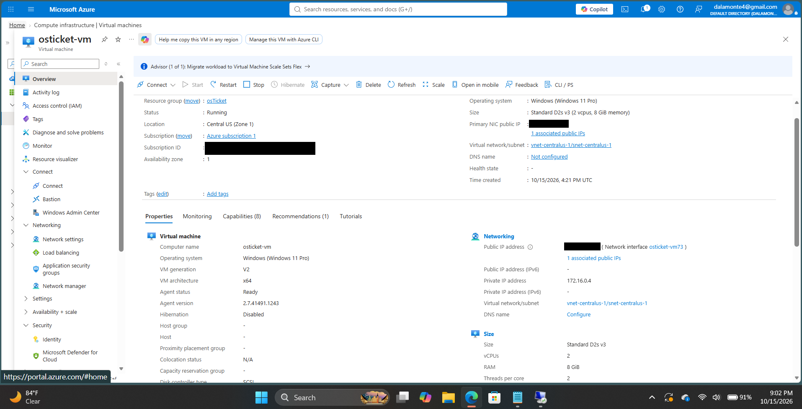

### 1.2 Enable IIS and configure PHP

1. Opened **Control Panel → Programs → Turn Windows features on or off**.
2. Enabled **Internet Information Services → World Wide Web Services → Application Development Features → CGI**.
3. Installed PHP Manager for IIS and the IIS Rewrite Module.
4. Extracted PHP 7.3.8 to `C:\PHP` and installed the required Visual C++ Redistributable.
5. In **IIS Manager → PHP Manager**, registered `C:\PHP\php-cgi.exe`.
6. Restarted IIS and enabled `php_imap.dll`, `php_intl.dll`, and `php_opcache.dll`.

**Result:** IIS and PHP dependencies were configured for osTicket.

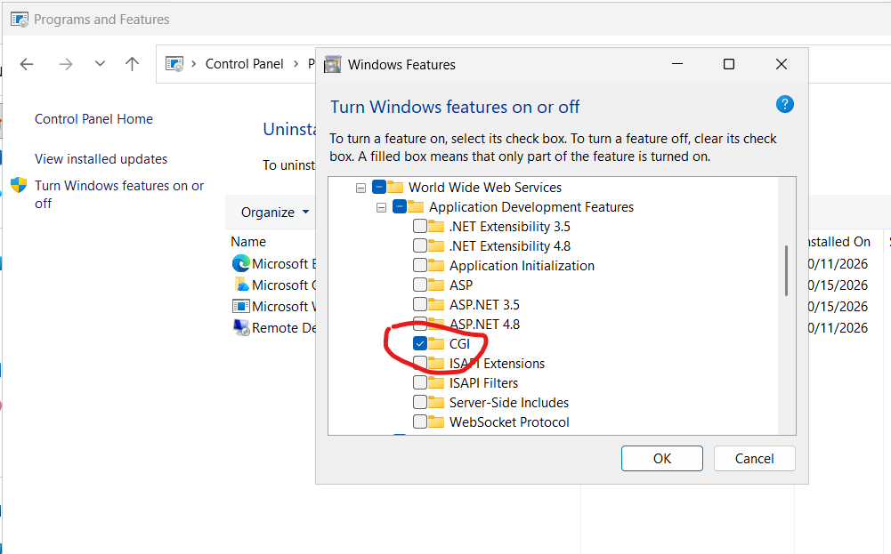

### 1.3 Configure the MySQL database

1. Installed MySQL and completed its local configuration wizard.
2. Opened HeidiSQL and connected to the local MySQL server.
3. Created the `osTicket` database for the installation.
4. After installing osTicket, inspected the populated tables in HeidiSQL.

**Result:** Verified that the application database and its tables were accessible. 

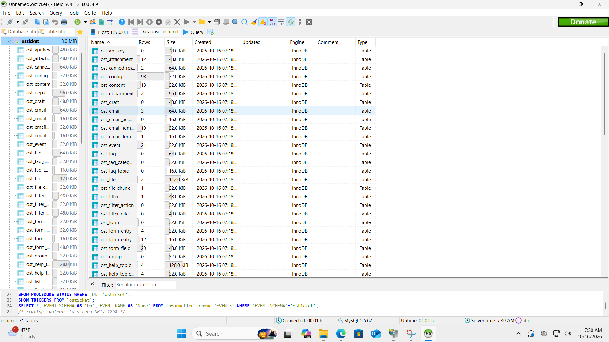

### 1.4 Deploy and verify osTicket

1. Extracted the osTicket v1.15.8 package and copied its `upload` directory into `C:\inetpub\wwwroot`.
2. Renamed that directory to `osTicket` and opened the local site through IIS.
3. Renamed `include\ost-sampleconfig.php` to `include\ost-config.php` and prepared the configuration file for installation.
4. Entered the help desk settings and `osTicket` database details in the browser installer.
5. Selected **Install Now!** and verified the successful installation page.

**Result:** The osTicket application was installed and accessible for administration.

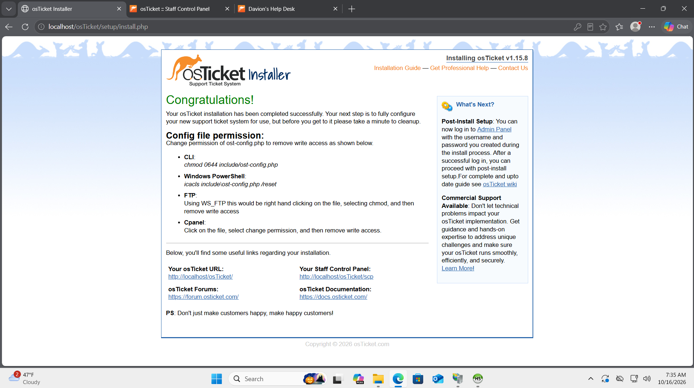

**Local VM URLs:** Staff login: `http://localhost/osTicket/scp/login.php` · End-user portal: `http://localhost/osTicket/`. 

## 2. Help Desk Administration

### 2.1 Roles and permissions

1. Opened **Admin Panel → Agents → Roles**.
2. Configured and reviewed the **Supreme Admin** role and its ticket permissions.
3. Compared permitted actions such as assigning, editing, transferring, and closing tickets.

**Lesson:** Authentication identifies an account; authorization determines which actions it may perform.

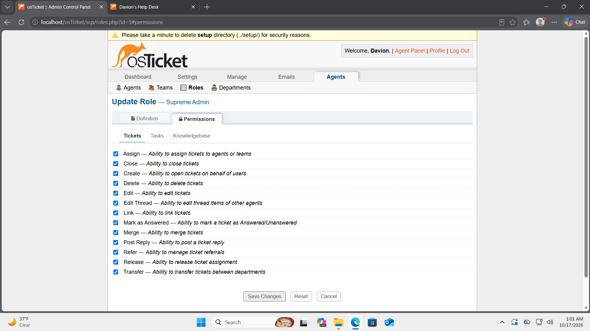

### 2.2 Departments and teams

1. Opened **Admin Panel → Agents → Departments** and configured **SysAdmins** alongside **Support**.
2. Set SysAdmins as a top-level department and removed the unused Maintenance department during the lab workflow.
3. Opened **Admin Panel → Agents → Teams** and created the **Online Banking** team.
4. Reviewed how departmental assignments affect ticket visibility and escalation.

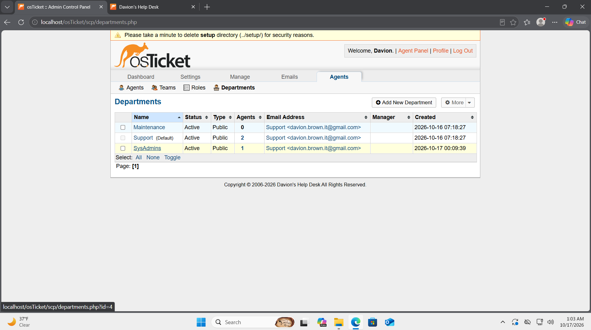

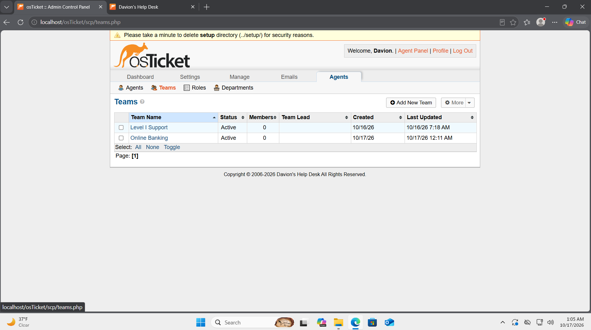

### 2.3 Agents and end users

1. Opened **Admin Panel → Agents → Add New**.
2. Configured **John Doe** in Support and **Jane Doe** in SysAdmins.
3. Used **Agent Panel → Users → Add User** to create simulated end users **Karen** and **Ken**.
4. Later added **Celeste Brown** for the independent CFO scenario.

**Result:** Practiced user provisioning, department assignment, and agent-versus-administrator workflows.

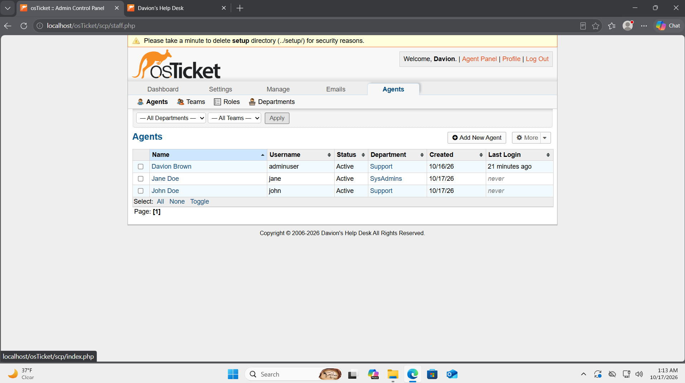

### 2.4 SLAs and help topics

1. Opened **Admin Panel → Manage → SLA** and configured:

   | SLA plan | Grace period | Training schedule |
   |---|---:|---|
   | Sev-A | 1 hour | 24/7 |
   | Sev-B | 4 hours | 24/7 |
   | Sev-C | 8 hours | Business Hours |

2. Opened **Admin Panel → Manage → Help Topics**.
3. Configured or reviewed topics for **Business Critical Outage, Personal Computer Issues, Equipment Request, Password Reset,** and **Other**.

**Result:** Created differentiated service targets and categories for support requests. The SLA screenshot verifies grace periods.

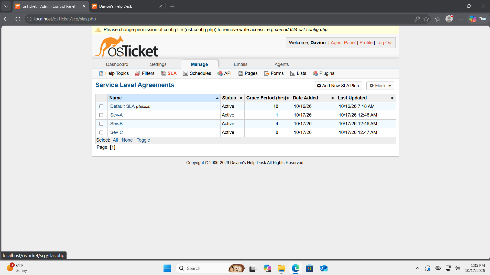

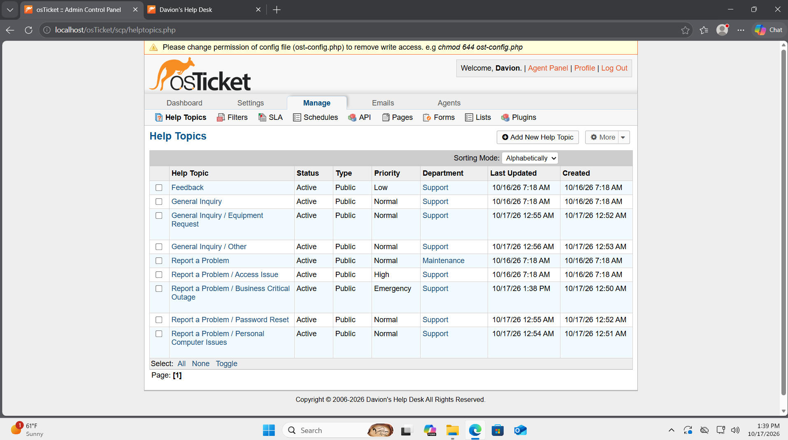

## 3. Ticket Management & Access Control

### 3.1 Banking outage: incident intake and escalation

1. Created a simulated ticket reporting that mobile and online banking were unavailable.
2. Viewed ticket **#155971** as support agent John Doe.
3. Examined its initial **Normal** priority, **Support** department, **Default SLA**, and unassigned status.
4. Evaluated the outage as business-critical and practiced escalation using the **Sev-A (1-hour)** training plan.
5. Investigated why department access could restrict John from viewing or changing a transferred ticket.

**Lesson:** A ticket's initial defaults may not match its business impact. Transferring a ticket can change who is authorized to work on it.

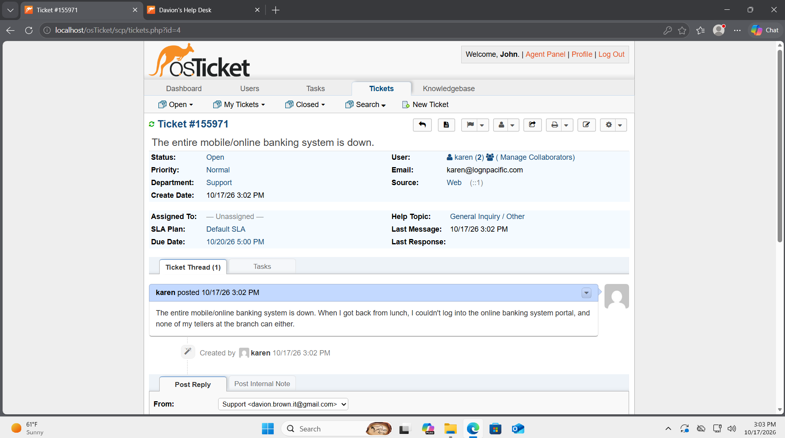

### 3.2 Investigate access restrictions

1. Opened **Admin Panel → Agents** and examined John's department access and effective role.
2. Reviewed the difference between primary-department access and additional permissions.
3. Compared administrator visibility with the permissions available to a Support agent.

**Result:** Investigated role-based permissions and department access restrictions to understand how authorization affects ticket visibility and technician responsibilities.

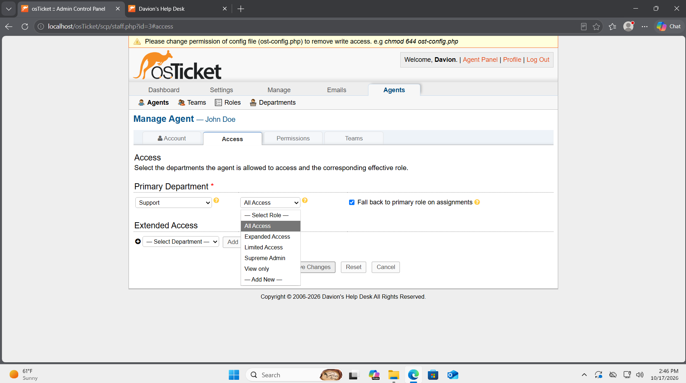

### 3.3 Accounting Adobe issue

Worked through a simulated Adobe software issue for the Accounting department, using **Support** and the **Sev-B (4-hour)** SLA. The closed-ticket queue confirms ticket **#603382** was closed under **John Doe**.

## 4. Independent CFO Laptop Troubleshooting Scenario

### 4.1 Create the end user and ticket

Created fictional CFO **Celeste Brown** and entered ticket **#936362** about a company laptop that would not power on.

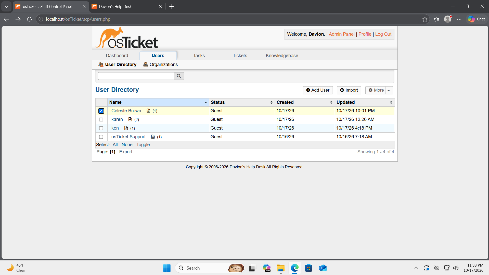

| Ticket property | Configuration |
|---|---|
| Subject | CFO laptop will not power on |
| Priority | Normal |
| Department | Support |
| SLA | Sev-B (4 hours) |
| Assigned technician | John Doe |
| Help topic | Personal Computer Issues |
| Source | Phone |

The scenario described a time-sensitive financial presentation and inability to access work files.

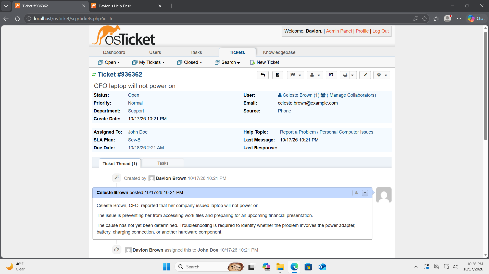

### 4.2 Record a troubleshooting plan

Entered an internal note describing a **proposed**, not physically executed, diagnostic sequence:

1. Check power LEDs, fan activity, and startup symptoms.
2. Inspect the power adapter, outlet, cable, and charging port.
3. If available, try a known-good compatible charger.
4. Distinguish a power failure from a display or startup issue.
5. Consider a manufacturer-approved power reset.
6. Assess business impact and the need for a loaner laptop.

**Simulated outcome:** A later note documented a *hypothetical* faulty charger replacement that restored startup. No hardware diagnosis or repair was actually performed.

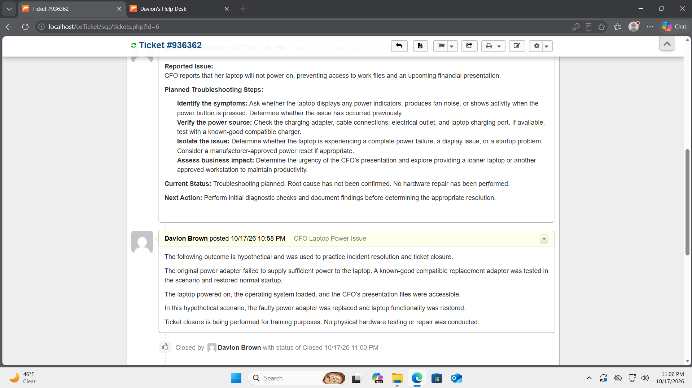

### 4.3 Close the ticket and inspect the audit trail

Reviewed the closed-ticket queue and confirmed:

- **#936362 — CFO laptop issue:** closed by the **Davion Brown administrator account**.
- **#603382 — Accounting Adobe issue:** closed by **John Doe**.

Although CFO ticket #936362 was assigned to John Doe, **I mistakenly documented the troubleshooting notes and closed it while signed in as administrator**. The history preserved the account that actually performed the work.

**Lesson:** Assignment and action attribution are different. Correct technician sign-in matters for permission testing and an accurate audit trail.

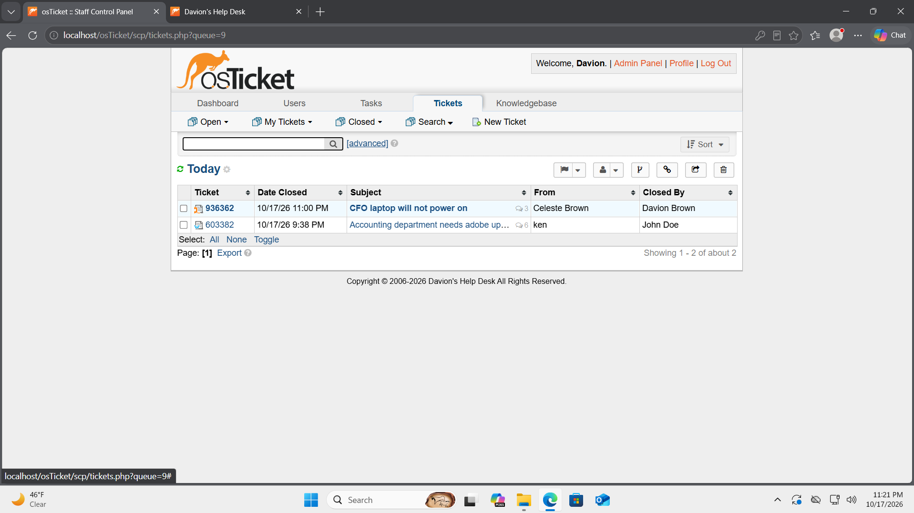

## 5. Key Lessons Learned

- **Application dependencies:** IIS, PHP, and MySQL must work together to support a web-based help desk.
- **Access control:** Successful sign-in does not guarantee permission to view or change a ticket.
- **Prioritization:** Business impact and urgency matter more than the initial ticket defaults.
- **Ticket documentation:** Record observations, planned tests, simulated outcomes, and verified actions distinctly.
- **Accountability:** Ticket history reveals who actually performed an action, not merely who was assigned.
- **Security:** A successful installation does not imply completed hardening.

## 6. Project Scope & Security Notes

This lab used **simulated users and incidents**, legacy training software, and a local virtual-machine environment. The banking, Adobe, and CFO incidents were not real organizational support requests. The CFO charger replacement was hypothetical.

The post-installation security cleanup steps—removing the setup directory and restricting write access to ost-config.php—were not completed during the lab. As a result, security warnings remained visible in the screenshots.

## 7. Career Relevance

This project demonstrates practical exposure to help desk administration, ticket intake, SLAs, permission troubleshooting, technical documentation, and ticket lifecycle tracking—skills relevant to entry-level **Help Desk Technician, IT Support Specialist,** and **Service Desk Analyst** roles.
